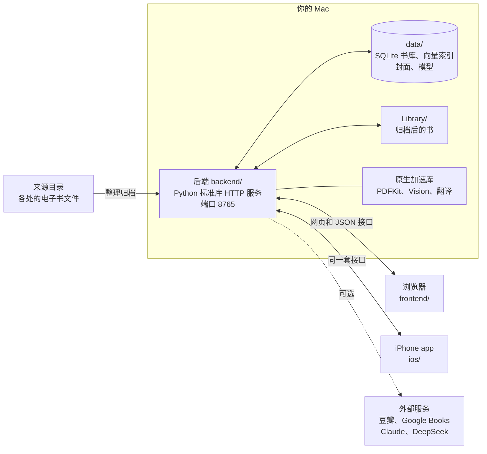

# 我的智能图书馆（my-smart-library）

一个跑在自己 Mac 上的私人电子书库：把散落在各处的电子书整理成一个书库，能搜、能推荐、能在浏览器和 iPhone 上直接读。数据和模型都在本机，不依赖任何云端书库服务。

规模（截至 2026-11）：约 2.16 万本书、2.7 万个文件、263 GB，6 种格式（PDF、EPUB、AZW3、MOBI、DJVU、TXT），15 个分类。

## 五个特点

### 1. 整理归档：把一堆文件变成一个书库

- 扫描多个来源目录，读出每个文件的书名、作者、语言和目录，归档到 `Library/`，原文件不动。
- 自动去重：同一本书的不同格式、不同副本归到一条记录（已合并约 5,600 个重复文件）。判断"是不是同一本书"看文件内嵌的元数据和 ISBN，不只看文件名。
- 合并错了可以拆：误合并的记录能拆开，每次拆分都能撤销。
- 书目信息补全：从豆瓣、Google Books、OpenLibrary 拉评分和简介，合成一个综合评分（评价人数少的评分会向平均分收敛），并算出每本书的"经典度"。

入口：网页的「定期整理与收件箱」页，或 `backend/cli.py organize`。

### 2. 搜索：用一句话找书

- 两路召回：关键词全文检索（SQLite FTS5 的 BM25）加语义向量检索（BGE-M3，1024 维）。
- 重排：前 12 本用 bge-reranker-v2-m3 交叉编码器再判断一次相关性。
- 支持自然语言描述（"讲认知偏差的入门书"）、拼音和拼音首字母、中英文互查。
- 可选「AI 精排」：DeepSeek 为前 20 本打分重排，失败或超出费用上限时保留标准排序。

入口：「书架与毫秒检索」和「按描述推荐 Top 10」两页。

### 3. 推荐：按你读过和想读的书来推

- 阅读足迹：每本候选书的得分取决于它离你标记的书（收藏、在读、已读、想读、高分）有多近，推荐理由会写明"与你标记的《X》相近"。
- 兴趣描述：你写下的每一句关注点各有名额。
- 不扎堆：按类别分组轮流出书，同一作者只出一本，同一本书的其他版本不重复推荐。
- 探索：按你设的比例，从你标记最少的类别里挑经典。
- 详情页另有"语义相似好书"。

入口：「兴趣罗盘与个性化推荐」页。

### 4. 阅读：打开浏览器就能读

- EPUB、MOBI、AZW3、TXT 转成网页排版阅读；PDF 在电脑上用 pdf.js，在手机上显示服务器渲染好的页面图片，滑动不卡。
- 双语对照：PDF 原文和译文左右并排，按段落对齐，分隔条可以拖动；其他格式支持划词和整段翻译。
- 翻译引擎可选：Claude、DeepSeek、Apple 本机、Google、MyMemory，自动模式下依次回退。
- 阅读进度保存在服务器，换设备接着读。

### 5. 私有与多端：数据在自己手里，手机也能用

- 所有数据在 `data/` 和 `Library/`，都不进 git。搜索和推荐用的模型在本机运行（ONNX Runtime）。
- 局域网访问要口令：手机第一次打开带 `?token=` 的地址，之后免口令。装了 Tailscale 时外网也能访问。
- iPhone app：把网页包进原生外壳，书可以整本下载到手机离线阅读，离线时的进度在重新连上后回传。

## 系统全貌



- **后端**不用 Web 框架，只用 Python 标准库的 HTTP 服务；第三方依赖只有 numpy、onnxruntime、tokenizers 和 anthropic。
- **前端**是一个 `index.html` 加十几个原生 JS 模块，没有构建步骤。
- **外部服务都是可选的**：不配任何 API key，整理、搜索、推荐、阅读照常工作，只是没有 AI 精排、AI 翻译和外部评分。

## 快速开始

环境：macOS（原生加速库用到 PDFKit 等系统框架）、Python 3.9 以上、Xcode 命令行工具（提供 `clang`）。

```bash
python3 -m venv .venv
```

```bash
.venv/bin/pip install -r requirements.txt
```

```bash
bash start.sh
```

`start.sh` 会在需要时编译原生库，然后启动服务并打印访问地址：

- 本机：`http://127.0.0.1:8765`
- 手机或平板：用启动时打印的局域网地址，口令在 `data/lan_token`

语义搜索和推荐需要两个模型放在 `data/models/` 下：`bge-m3/` 和 `bge-reranker-v2-m3/`（ONNX 量化版加 `tokenizer.json`）。没有模型时退回纯关键词搜索。书的向量索引用 `backend/build_bge_index.py` 生成。

注意：`start.sh` 里写的是本机的绝对路径，换机器要改。

## 配置

环境变量，全部可选：

| 变量 | 作用 |
|---|---|
| `ANTHROPIC_API_KEY` | Claude 翻译 |
| `DEEPSEEK_API_KEY`、`DEEPSEEK_MODEL` | DeepSeek 翻译、AI 精排、书目整理（模型默认 `deepseek-flash`） |
| `GOOGLE_BOOKS_API_KEY` | Google Books 评分和简介 |
| `AI_DAILY_CAP_CNY` | 搜索与翻译合计的每日费用上限，默认 ¥5 |
| `LIBRARY_DATA_DIR`、`LIBRARY_CONFIG_PATH` | 数据目录和配置文件的位置 |

`data/config.json`，可选：

| 键 | 作用 |
|---|---|
| `source_dirs` | 要扫描的来源目录，每个带名称、可信度权重和优先级 |
| `google_books_api_key` | 同上面的环境变量 |
| `claude_translate` | 设为 `false` 时不调用 Claude 翻译（比如账户没有余额时） |

Apple 本机翻译需要 macOS 26，并在"系统设置 › 通用 › 语言与地区 › 翻译语言"里下载英语和中文语言包。

## 目录结构

| 路径 | 内容 |
|---|---|
| `backend/server.py`、`backend/http_api/` | HTTP 服务：路由、局域网口令、各接口的处理函数 |
| `backend/archiver.py`、`backend/ebook_parser/`、`backend/same_work.py` | 扫描、解析、去重、同书归并与拆分 |
| `backend/search/` | 搜索与推荐：召回、打分、重排、兴趣推荐 |
| `backend/semantic_models.py` | BGE-M3 向量与重排模型 |
| `backend/book_reader/`、`backend/pdf_page_service.py` | 各格式转成可阅读的内容，PDF 页面渲染 |
| `backend/enrichers/`、`backend/classic_scorer.py`、`backend/ratings.py` | 外部评分与简介、经典度、综合评分 |
| `backend/translator.py` | 翻译引擎与回退 |
| `backend/native/` | Objective-C 和 Swift 写的原生加速库 |
| `backend/migrations.py` | 数据库结构的版本迁移 |
| `frontend/` | 网页前端 |
| `ios/` | iPhone app，见 [ios/README.md](ios/README.md) |
| `tests/` | 测试和离线评估的基线 |
| `data/`、`Library/` | 书库数据和归档后的书，不进 git |

## 开发与测试

```bash
.venv/bin/python -m unittest discover -s tests -p "test_*.py"
```

约 280 个测试，80 秒左右。其中有三类门禁值得知道：

- **代码规范门禁**（`tests/test_code_standards_gate.py`）：函数不超过 50 行、嵌套不超过 3 层、参数不超过 3 个、文件不超过 500 行。
- **搜索质量门禁**（`tests/test_search_quality.py`）：用 `tests/search_eval/queries.json` 里标注好的查询评估书架搜索，nDCG 不得低于基线 0.02 以上，Hit@3 不得低于基线 0.05 以上，Bad@5 不得增加。
- 这两类质量测试直接读本机的 `data/library.db`，书库数据变化时结果会跟着变。

两套离线评估，改排序算法前后各跑一次：

```bash
.venv/bin/python backend/eval_search.py --mode shelf -v --compare tests/search_eval/baseline.json
```

```bash
.venv/bin/python backend/eval_recommend.py --compare tests/search_eval/recommend_baseline.json
```

- 搜索评估的指标：nDCG@10、P@5、Hit@3（正中的书进前 3）、Bad@5。有意调整排序后用 `--save` 刷新基线。
- 推荐评估的做法：把你标记的书藏起一部分，看打分方法能把它们排到第几。基线只在同一份书库数据上可比。
- `SEARCH_EVAL_DESCRIBE=1` 同时评估"按描述推荐"（约 50 秒）；`SEARCH_EVAL_AI=1` 评估 AI 精排（每次约 ¥2，有缓存）。

DeepSeek 相关的离线工具：

- `backend/enrich_ai.py run`：为新书生成干净书名、关键词、难度和类型标签（存在 `book_ai_meta` 表，原字段不改）；`enrich_ai.py report` 输出分类不一致的清单。
- `backend/eval_build.py`：生成、标注、抽查评估用的查询。
- 费用：搜索与翻译受每日上限约束；离线整理与评估只记录不设限。「定期整理」页显示今日用量。

## 相关文档

- [系统分析与优化方案.md](系统分析与优化方案.md)：系统现状分析和历次优化的评审记录
- [代码规范重构与架构解耦方案.md](代码规范重构与架构解耦方案.md)：代码规范和模块拆分
- [同书归并与误合并拆分方案.md](同书归并与误合并拆分方案.md)：怎么判断两个文件是不是同一本书
- [推荐算法重构实施计划.md](推荐算法重构实施计划.md)：兴趣推荐的设计、实测数据和每个阶段的实施记录
- [docs/designs/ios-app.md](docs/designs/ios-app.md)：iPhone app 的设计决定

## 许可

GPL-3.0，见 [LICENSE](LICENSE)。
