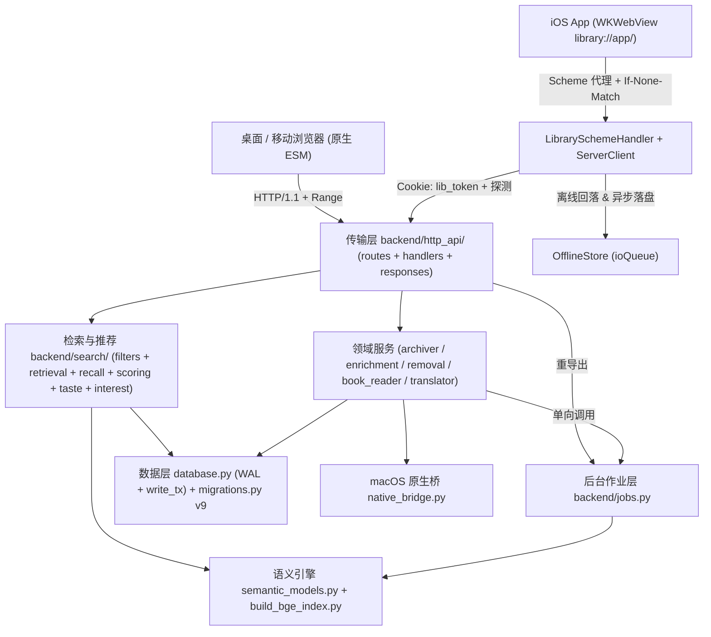

# 我的智能图书馆 — 架构审视与系统优化方案

> **编写日期**：2026-11-19
> **基线版本**：提交 `f6ec9a8`（分支 `public-main` / `public/main`，已完成第一、二、三批整改）
> **术语约定**：所有领域名词遵循 [GLOSSARY.md](../GLOSSARY.md)；不可逆架构取舍详见 [docs/adr/](adr/)
> **替代说明**：本文取代根目录历史快照 [系统分析与优化方案.md](../系统分析与优化方案.md)（2026-11-09 版）

---

## 1. 系统现状与体系结构总览

系统是一套面向个人藏书场景的**单机本地优先 + 零重框架 + 多端共享 HTTP API** 系统，全部源码约 **3.18 万行**，由单一 Python 服务端进程统一承载桌面 Web、移动端浏览器与 iOS 代理壳全部能力：

| 子系统 | 目录与代表文件 | 当前体量（2026-11-19 实测） | 核心职责 |
|---|---|---|---|
| **Python 服务端** | [backend/](../backend/)（含 `http_api/`、`search/`、`ebook_parser/`、`book_reader/`、`enrichers/`） | 91 个 `.py` 文件 · 16,633 行 | 零框架 `ThreadingHTTPServer` HTTP API、SQLite WAL 存储、混搜/推荐流水线、电子书解析与归档、ONNX 向量检索引擎 |
| **macOS 原生桥接** | [backend/native/libmacbookai.m](../backend/native/libmacbookai.m) | 1 个 Obj-C 源码 · 519 行 | 通过 `ctypes` 封装 PDFKit 渲染/文本/OCR、NaturalLanguage 词形/拼音与 Apple 本机翻译，可降级运行 |
| **零构建前端** | [frontend/index.html](../frontend/index.html)、`assets/js/`、`assets/css/` | HTML 596 行 + 14 个 JS 4,340 行 + 2 个 CSS 2,039 行 | 原生 ESM 书架检索、沉浸式多格式阅读器（HTML/PDF 图文/图片流）、双语对照、查词翻译与管理面板 |
| **iOS 客户端壳** | [ios/](../ios/) | 13 个 `.swift` 文件 · 1,843 行 | `WKWebView` 加载自定义 `library://app/` Scheme，原生长驻口令注入、局域网/Tailscale 探测、整本下载与读穿透缓存 |
| **自动化测试** | [tests/](../tests/) | 47 个 `.py` 文件 · 6,037 行 | AST 代码与架构棘轮、路由特征测试、搜索排序行为对比（`behaviour_diff.py`）与各端专项回归测试 |

### 1.1 分层拓扑图

---

## 2. 体系结构优势与核心护栏

1. **极简运行时依赖与本地数据主权**：服务端仅依赖 Python 标准库与轻量化计算/模型库，外部 AI 能力（DeepSeek / Claude / 豆瓣 / Google Books）全部支持按日配额熔断与离线降级；前端零构建、零第三方运行时打包链。
2. **完备的数据防损护栏**：
   - 同盘零拷贝建立 **书库硬链接** 并写入审计日志，物理删除或回滚前强制校验证据链（`st_nlink > 1`）防误删孤本（[archiver.py](../backend/archiver.py)）。
   - 多文件 **图书记录** 的软删除强制校验 `confirmed_file_ids` 精确集合；先短暂提交不可见标记再搬迁物理文件，落库失败自动反向移回文件并恢复可见性（[book_removal_service.py](../backend/book_removal_service.py)）。
   - FTS5 更新触发器带 `WHEN` 字段白名单守卫，消除阅读进度高频更新引起的全文索引写放大（[migrations.py](../backend/migrations.py)）。
3. **搜索推荐算法与评测闭环扎实**：`intent → recall → scoring → finalize` 分级清晰；兴趣推荐采用去均值中心化余弦与按聚类轮转取书防止单一热门题材刷屏，并保留 `tests/behaviour_diff.py` 支持跨 worktree 对比 nDCG / Hit@3 / Bad@5 基线。
4. **多层次自动化防腐蚀门禁**：
   - 后端 AST 门禁（[test_code_standards_gate.py](../tests/test_code_standards_gate.py)）：文件 ≤ 500 行、函数 ≤ 50 行且嵌套 ≤ 3 层、公共 API ≤ 3 参数、禁用未注明的静默异常，豁免清单实行“只缩不增”棘轮。
   - 架构与 Schema 棘轮（[test_batch3_decoupling.py](../tests/test_batch3_decoupling.py)）：禁止业务层反向导入 `http_api`、禁止迁移模块外动态 `CREATE TABLE`。
   - 前端静态门禁（[scripts/check_frontend_js.mjs](../scripts/check_frontend_js.mjs)）：全量 `node --check` 语法检查 + `jsconfig.json` `checkJs` 类型诊断 + 模块导入完整性检查（[test_frontend_imports.py](../tests/test_frontend_imports.py)）。

---

## 3. 已落地三批优化复盘（`33b7714..f6ec9a8`）

针对全系统审视暴露出的活 Bug、安全边界、并发竞态与模块耦合问题，已完成三批增量整改并推送至 `public/main`：

| 批次 | 提交哈希 | 规模 | 核心解决的问题与关键改动 |
|---|---|---|---|
| **第一批：止血修复** | `a3abd68` | 22 文件 `+256/-77` | 修复 5 个线上活 Bug（统一年代筛选、移动端 `matchMedia` 与字体短键、`AI_FALLBACK_TEXT`、阅读锚点挂载）；删除两处 `ssl._create_unverified_context()` 中间人降级；3 处删文件校验收紧为 `Path.resolve().is_relative_to()`；新增请求体大小上限、BCP-47 语言码校验、`libmacbookai.m` UTF-8 判空及 `gate.py` 防协议相对重定向；修绿 AST 门禁红灯 |
| **第二批：并发与稳态** | `932bc7c` | 19 文件 `+953/-325` | `database.write_tx()`（`BEGIN IMMEDIATE`）串行化写事务；AI 润色、慢速补全、软删除彻底退出“持连接跨网络/文件 I/O”；补充软删除物理回滚、`auto_summary_refresher` 30 分钟失败退避、`.tmp` 清理与 `SIGINT`/`SIGTERM` 优雅停机；`build_bge_index` 过滤 **软删除图书** 并按 passage 哈希增量重编码；`semantic_models` 加锁发布原子快照并用 `argpartition` 替换全排序；后端升级 `HTTP/1.1`、206 Range 分块流式（1 MiB）与 416 `Content-Length: 0`；iOS 代理放行 `ETag`/`If-None-Match`/`Cache-Control`、任务取消不再回落假离线、`OfflineStore` 移出主线程走串行 `ioQueue`、防 TOCTOU 清空进度 |
| **第三批：解耦与防腐蚀** | `f6ec9a8` | 35 文件 `+687/-306` | 抽出 [backend/jobs.py](../backend/jobs.py) 彻底切断 5 个领域模块对 `http_api` 的反向导入；`ai_usage` / `ai_rerank_cache` / `title_repair` 3 张野表收口进 Schema `v9`（`ai_search` 同时退出持连接等 DeepSeek HTTP）；在 [backend/search/filters.py](../backend/search/filters.py) 统一 `shelf`/`retrieval`/`interest` 三处 SQL 筛选构建器；建立零构建 `checkJs` 静态门禁，清理 `book_modal.js` 死调用 `doSearch()` 并清零前端 98 条诊断 |

### 当前验证基线

- **Python 回归与门禁套件**（`tests/` 下 19 个核心与回归模块，运行于 `f6ec9a8` 落盘前验证）：**159 / 159 通过**（耗时 `20.747s`），覆盖 Batch 1/2/3、AST 代码规范、Schema 迁移 `v9`、架构/DDL 棘轮、安全路线特征、图库删除与阅读路由。
- **前端静态检查**：`node scripts/check_frontend_js.mjs --require-ts` 对 14 个 ESM 文件检查 **语法 0 错误、`checkJs` 0 诊断**。
- **iOS 非 UI 编译检查**（第二批定稿时执行 `swiftc -parse-as-library -swift-version 5 -target arm64-apple-macosx14.0`）：13 个源码核心模块 + `SelfTest` 编译 **退出码 0**。

---

## 4. 架构决策记录（ADR）索引

- [0001：单进程 SQLite WAL 写入串行化，且严禁持数据库连接跨 I/O](adr/0001-sqlite-write-tx-and-no-io-under-conn.md) —— 以轻量 `write_tx()` + 断连接 I/O 原则保住单机部署模型，替代外部数据库进程。
- [0002：维持零构建原生 ESM 前端，并用 jsconfig + checkJs 补齐静态门禁](adr/0002-zero-build-esm-and-checkjs-gate.md) —— 在保留零编译热生效体验的同时消除重命名和 DOM 类型漂移盲区。
- [0003：抽出轻量后台作业模块 jobs.py 并以棘轮测试防架构腐蚀](adr/0003-flat-jobs-module-and-ratchet-tests.md) —— 解除传输层耦合的同时用自动化测试锁住扁平目录边界。
- [0004：iOS 采用自定义 Scheme 透明缓存代理与串行化磁盘读写队列](adr/0004-ios-scheme-proxy-and-serialized-offline-store.md) —— 解释自定义代理协议保留、缓存头透传与串行存储队列的底层动因。

---

## 5. 第四批演进待办路线图（Batch 4）

尚未动工的结构性与体验债收敛为以下 4 个工作包，按 **`4A → 4D → 4B → 4C`** 顺序推进：

### Phase 4A｜安全与配置收口（优先）
- **配置源五合一与读 Key 统一**：目前配置分散在环境变量、`local/config.json`（存在即完全屏蔽 `data/config.json`）、数据库 `user_interest_config`、`data/lan_token`，且 [deepseek_client.py](../backend/deepseek_client.py) 会回退读取库内 `llm_api_key`，而 [translator.py](../backend/translator.py) 只读环境变量。计划收口为统一只读配置对象（分层叠加而非整体互斥）与单一凭据解析入口。
- **iOS 探测凭据与传输边界评估**：[ServerClient.swift](../ios/Library/ServerClient.swift) 的 `probe()` 向配置列表中全部候选地址附带 `lib_token` 请求 `/api/connection`；同时 [ios/Info.plist](../ios/Info.plist) 因需兼容 Tailscale（`100.64.0.0/10`）明文 HTTP（Apple `NSAllowsLocalNetworking` 不覆盖该网段且设置后会屏蔽 `NSAllowsArbitraryLoads`），目前开启了全局 `NSAllowsArbitraryLoads`。下一步评估：先在无凭证轻量探测或已知指纹校验后再附带 `lib_token`；在部署支持 Tailscale Serve HTTPS 时探索收紧 ATS 范围。

### Phase 4D｜三端统一验证入口
- **一键本地全检脚本 `scripts/verify.sh`（及可选 CI）**：将 Python 核心测试（`unittest` + AST 门禁 + Batch 1/2/3 架构测试）、`node scripts/check_frontend_js.mjs --require-ts` 与 macOS `swiftc` 交叉编译收敛到单个可执行脚本，作为发版与合入前的强制单命令验证入口（本地缺真实书样本的用例显式归入可选集成标签，避免与核心单测混淆报错）。

### Phase 4B｜检索热路径性能与可维护性
- **收敛 `recall.py` 最多 9 次全表 `LIKE '%...%'` 扫描**：[backend/search/recall.py](../backend/search/recall.py)（200 行）在非拼音路径下会按最多 4 个主词 + 同义词组 + 4 次 `book_ai_meta.keywords LIKE` 执行多达 9 轮模糊扫描。计划将其合并为更紧凑的索引/FTS5 扩展或按需回落，显著降低长尾词并发检索 P99 时延。
- **拆分 `scoring.py` 超长函数与外置权重表**：[backend/search/scoring.py](../backend/search/scoring.py) 的 `pre_score_candidates` 目前达数百行且内嵌大量经验启发式权重（仍在 `ALLOWED_FUNCTION_EXEMPTIONS` 豁免名单中）。计划拆解信号计算子步骤并外置权重常量表，每次重构均以 `tests/behaviour_diff.py` 对 nDCG / Hit@3 零回退为硬门禁，趁势缩减 AST 豁免清单。

### Phase 4C｜前端模块化深化
- **打破三方 ESM 循环依赖与全局倾倒**：解除 `reader.js` ↔ `reader_pdf.js` ↔ `reader_translate.js` 相互导入的三方环（通过事件总线或单向桥接模块）；收敛 [main.js](../frontend/assets/js/main.js) 向 `window` 挂载约 78 个符号的做法为单一命名空间或事件委托。
- **拆分超 500 行前端文件**：对超过 500 行的 7 个前端源码逐步按职责拆分并同步扩展门禁监控范围：
  - [reader.css](../frontend/assets/css/reader.css)（1,121 行）、[main.css](../frontend/assets/css/main.css)（918 行）
  - [reader_translate.js](../frontend/assets/js/reader_translate.js)（855 行）、[reader.js](../frontend/assets/js/reader.js)（825 行）、[reader_pdf.js](../frontend/assets/js/reader_pdf.js)（560 行）
  - [shelf.js](../frontend/assets/js/shelf.js)（573 行）、[index.html](../frontend/index.html)（596 行）
